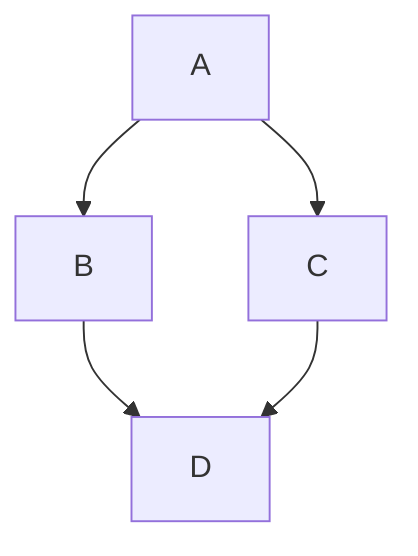

# Esta es una prueba para la pagina web

texto aquí

## Softwares de texto plano usados

- [Sublime](https://www.sublimetext.com/download)
- [MarkText](https://www.sublimetext.com/download)
- [Obsidian](https://obsidian.md)

### Paso 1

1. https://pandoc.org/installing.html
2. [Download the latest installer](https://github.com/jgm/pandoc/releases/latest)
3. [pandoc-3.11-windows-x86_64.msi](https://github.com/jgm/pandoc/releases/download/3.11/pandoc-3.11-windows-x86_64.msi)
4. Ejecutar instalador .msi
5. Ejecutar en PowerShell `pandoc .\mark_text_test.md -o .\mark_text_test.docx`

